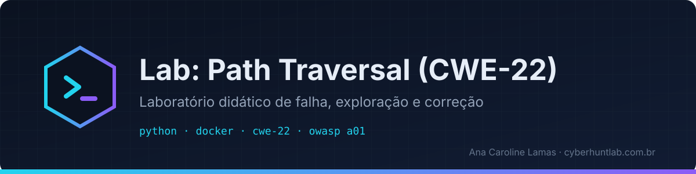

<p align="center"></p>

# Lab: Path Traversal (CWE-22) — laboratório didático de segurança

Laboratório para estudar **path traversal (CWE-22)**: uma aplicação com a falha, a demonstração da exploração contra um container local e a correção. Serve para treinar **revisão de código** e como caso de teste de regressão para ferramentas de **SAST**.

> **Em construção**: a documentação está pronta, mas o código (aplicação, exploit e patch) ainda não foi publicado neste repositório.

## Estrutura planejada

```
app-vulneravel/     aplicação com a falha
exploit/            prova de conceito contra o container local
patch/              diff com a correção
docs/analise.md     explicação técnica
docker-compose.yml
```

## A falha

A aplicação recebe um caminho do usuário e o concatena à raiz de arquivos antes de abri-lo. Sem normalização e verificação, `../` sai do diretório previsto e alcança arquivos de configuração do servidor.

**Normalizar não basta se o resultado não for verificado.** A correção resolve o caminho absoluto e confirma que ele continua dentro da raiz permitida:

```python
# vulnerável
caminho = os.path.join(RAIZ, entrada_usuario)
return open(caminho).read()

# corrigido
caminho = os.path.realpath(os.path.join(RAIZ, entrada_usuario))
if not caminho.startswith(os.path.realpath(RAIZ) + os.sep):
    raise PermissionError("caminho fora da raiz permitida")
return open(caminho).read()
```

## Como usar (quando o código for publicado)

```bash
git clone https://github.com/ticarollamas-arch/lab-path-traversal.git
cd lab-path-traversal
docker compose up -d
python exploit/poc.py --alvo http://localhost:8080
```

> **Uso restrito ao laboratório**: a aplicação é vulnerável de propósito e deve rodar isolada em container. Não a exponha na internet nem aponte o exploit para sistemas de terceiros.

## Ferramentas relacionadas

- [varredor-vulnerabilidades](https://github.com/ticarollamas-arch/varredor-vulnerabilidades): triagem estática com regra CWE-22.
- [go-traversal-detector](https://github.com/ticarollamas-arch/go-traversal-detector): detector de path traversal em código Go.

## Referências

- CWE-22: Improper Limitation of a Pathname to a Restricted Directory
- OWASP Top 10: A01 — Broken Access Control

## Licença

Distribuído sob a licença MIT. Veja [LICENSE](LICENSE).
